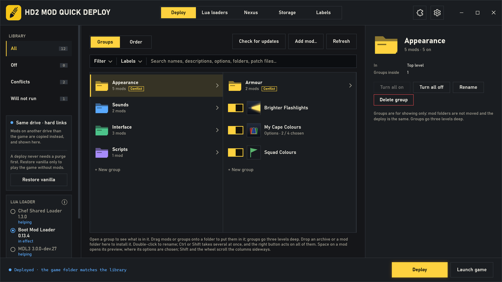
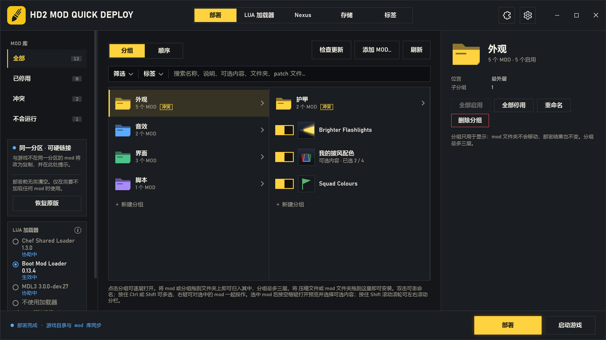

# HD2 Mod Quick Deploy

A mod manager for Helldivers 2. What sets it apart:

- **Deploys in under half a second, writing no mod data.** It never empties the
  game folder to copy everything back: it compares what the load order needs
  with what is in the game folder and touches only the files that differ, and a
  deployed file is a hard link to the library's own file. A typical deploy takes
  0.13–0.29 s (measured); a purge-and-copy manager writes the whole mod set every
  time.
- **Conflicts by game item.** The *Conflicts* view gives each armor, helmet or
  other game item that several mods change a card of its own, with every mod
  and option involved, enabled or not. One click chooses whose version the game
  uses, and turns no other mod off.
- **The Lua mod loaders looked after.** Boot Mod Loader, Chef Shared Loader and
  MDL3 are chosen once in a panel, not ordered by hand. A deploy adds the
  helpers the enabled mods need, and every Lua script is checked against the
  game's Lua before the game starts.
- **Groups, labels and profiles.** Mods sorted into folder-style groups up to
  three levels deep; no file is moved for it.
- **Update checks with no sign-in**, for mods from Nexus Mods and GitHub,
  archives downloaded by hand included, with what each version changed; once a
  day when the window opens.
- **Plugins.** Asset check, Model repair, HD2 Mod Console and more, each added
  only when it is wanted.
- **Problem reports.** One upload gives a report number to pass to the mods'
  author.

It comes in two parts that share one library and one set of settings:

- **HD2 Mod Quick Deploy** — the window, for players;
- **hd2qd** — the command line, for mod makers and scripts.

[中文说明在下面](#中文)

## How much writing and time it saves

Measured on the author's library: 68 mods, 284 patch files, 2.84 GB in the
game folder, library and game on one NTFS drive.

| You change | A purge-and-copy manager writes | HD2 Mod Quick Deploy writes | Deploy time |
|---|---|---|---|
| Nothing | 2.84 GB | **0 B** | 0.13–0.18 s |
| One mod's version (a new zip) | 2.84 GB | **0 B** — 1 hard link, 1 delete | 0.14–0.29 s |
| A mod turned off | 2.84 GB | **0 B** — 109 renames, 69 deletes | 0.23 s |
| The same mod turned back on | 2.84 GB | **0 B** — 109 renames, 69 hard links | 0.23–0.25 s |
| A mod moved in the load order | 2.84 GB | **0 B** — 82 renames | 0.19–0.21 s |
| Space taken in the game folder | 2.84 GB of copies | **0 B** — hard links | |

"0 B" is mod data: renames, links and deletes still change a few KB of file
system entries, and each deploy saves its record (about 100 KB). The times
include starting `hd2qd.exe` (26 ms) and were taken with the files already in
Windows' cache; slower are the first deploy after Windows starts (not
measured), the first comparison of two large identical files (read once, then
remembered) and a new zip, which is unpacked once (0.58 s for a 55 MB zip).

Ten such changes in one session write 28 GB to the drive with
purge-and-copy, and only file entries here. The window counts it for you on its *Storage* page
(*Writes saved*): three deploys on that library saved 8.51 GB.

Coming from another manager: one click on *Make hard links* (or
`hd2qd relink`) turned its 284 copies into hard links in 2.5 s, writing
nothing and giving 2.84 GB back.

When the library is on another drive than the game, hard links are not
possible and changed files are copied; the deploy is still incremental, so
updating a 5 MB mod writes 5 MB, not 2.84 GB.

## How it does it

- a file that is already right is left alone;
- a mod moved in the load order, or renumbered because another was turned off,
  is **renamed**, not copied;
- a new file is a **hard link** to the library when both are on one drive (a
  copy otherwise);
- a file that is no longer wanted is deleted.

## Requirements and download

- Windows 10 (1903 or later) or Windows 11.
- Nothing to install: both programs need only the .NET Framework 4.8 that
  Windows comes with.
- Download from [Releases](https://github.com/pat-pat-patrick/hd2-mod-cli/releases):
  `HD2.Mod.Quick.Deploy.exe` (the window) and, if you want it, `hd2qd.exe` (the
  command line). Put them in any folder and run them.
- The releases there are **developer builds**: they have everything but
  downloads from Nexus Mods (see *Nexus Mods*). Their own update check also
  offers the next developer build.

## The window

### The first start

1. Open `HD2 Mod Quick Deploy.exe`.
2. It finds the game folder by itself (from HD2 Arsenal's settings, Steam's
   registry entries or Steam's library list). If it cannot, it asks for it:
   choose the game folder, its `data` or its `bin` folder.
3. If your library is empty, it lists the mod managers found on this computer
   (HD2 Arsenal, HD2ModManager, Echelon) and offers to import their lists: the mods,
   their order, on/off and options. Their files are only read, and a mod found
   in more than one is imported once. HD2 Arsenal's list is read in its earlier
   shape and in the one of 0.37 (the mods kept once, the profiles naming them).
   A list that is found but cannot be read is said, with where it is; it is never
   left out as if there were none.
4. Mods that are on another drive than the game are pointed out, with what
   moving them gives (see *Mod folders*). Nothing is moved unless you choose to.

### What is where

| Part | What it shows and does |
|---|---|
| Title bar | The pages **Deploy / Lua loaders / Download / Storage / Labels** (the developer build calls *Download* **Nexus**). On the right: the buttons of plugins shown in the title bar, the **jigsaw** for the Plugins page, and the **gear** for the settings. The gear gets a red dot when a newer version of this program is out, the jigsaw when an added plugin has a newer release. |
| Settings | Two tabs. *General*: the language, profiles, display order (*1 at the top* or *1 at the bottom*; what wins in the game stays the same), the lines that explain things, the jump button for a fast wheel, keeping the previous version of script mods, the update check when the window opens. *About and diagnostics*: this program's version, its updates and *What's new*, the problem report, the manager's log, who made it and where it comes from. |
| Library (left) | **All**, **Off** and **Conflicts** (which opens the Conflicts view), each with its count; **Updates**, **Cannot be read** and **Will not run** appear when a mod is in them. |
| Deploy target (left) | Whether the library and the game share a drive (hard links) or not (copies). When the game holds copies that could be hard links, **Make hard links** frees their space without writing anything. **Restore vanilla** takes every mod out of the game, for playing without mods. **Undo changes not deployed** appears after a change to which mods are on, their order or their options: it puts them back as the last deploy left them. |
| Lua loader (left) | The library's loaders, each with its state (in effect, helping, not used), and one ring to choose the loader in effect; see *Lua mods before a deploy*. |
| Above the list | **Groups / Order** switches the view; **Check for updates**, **Add mod…**, **Refresh**. With profiles on, the profile's name is shown too. |
| Filter, Labels, Search | **Filter** narrows the list by what a mod is (Lua mods, or files only, no scripts) and where it comes from (Nexus Mods, GitHub, source not recorded). **Labels** narrows it to your own labels: a mod shows when it carries any of the labels ticked; Alt+click a label to hide the mods that carry it. **Search** finds mods by any word in their metadata, not only the name: the author's description, options and their descriptions, folders, patch file names (archive ids), Nexus mod ids, script names, *lua*, *loader*, and your own labels. Several words: all must match. Typing on the list goes to the search box. |
| Groups view | Your groups as columns, like folders: open a group to see what it holds, drag mods or groups onto a folder to put them in it, *+ New group* to make one. Groups go three levels deep and are for showing only: no file is moved and the deploy is the same. A group's details turn all its mods on or off, rename it or delete it (its mods move up a level). Shift and the wheel scroll the columns sideways. |
| Order view | The load order, top to bottom: **a mod lower in the list wins** (or higher, with *1 at the bottom*). Each row: its number, its switch, its picture, its name, and under the name its version, what is chosen, a **LUA** tag when it runs scripts in the game and a **LOADER** tag when it replaces one of the game's own scripts the way a mod loader does; on the right a mark that checks this one mod for updates, its size and how it is deployed. Drag a row to move it. Turning the wheel fast shows **To the top** or **To the end** beside the pointer (a setting, on by default). |
| In both views | Dropping a zip, 7z or rar, or a mod folder, installs it. A new version of a mod already in the library takes that mod's place, keeping its position, switch and options: at once when the manifest Guid or the download source (the same Nexus Mods mod or GitHub repository) shows it is the same mod, and after a question when only the name matches once versions and dates are set aside. Double-click a mod to give it a name of your own (the name it came with stays in its details); Ctrl or Shift takes several mods at once: drag one of them and they all move together, in the order they have; the right button turns them all on or off, moves them, puts them in a group, removes them or deletes them from the disk. **Space** opens a mod's preview. |
| Preview (Space) | The mod's cover, its switch and description, and its options as cards with their pictures, names, descriptions and sizes. A group of options is *pick one* (Ctrl+click for more); parts can each be on or off. A card names the enabled mods that option would conflict with. Space or Esc closes it. |
| Conflicts view | One card for each game item several mods change; see *Conflicts*. |
| Details (right) | The author's description (or, when the mod folder has none, what its site says), the load order, its group, the folder, **Delete** (red), **Remove** and **Open folder**; **Replaces**: the game items it replaces; what the next deploy does to this mod (kept, renamed, new); its conflicts with other mods; the resources another mod ships byte for byte alike (shared, not fought over); its updates and its source (*Set source…*, *Match the source*); for a Lua mod, its scripts and what they need. |
| Lua loaders page | Everything about the Lua loaders on one page. At the top: the loader in effect, how many Lua mods start, will not start or cannot run, and the conflicts. Then a card per loader in the library, and one for no loader: which Lua mods would not start under it and why, its previous version, an update when one was found, MDL3's native part, Boot Mod Loader's last session; *Use this loader*, *Log*, and in *More…* details, check for updates, a new version from a zip or folder, roll back, open folder, remove, delete. Then, for each pair of the library's loaders, whether they can be used together, how and under what conditions. Then the conflicts between the mods' scripts (start-up scripts, a script name declared twice, a translation pack without its mod), every Lua mod with its switch and what it does under the loader in effect, and the loaders' own logs: by loader and file, by level (errors, warnings, info, debug), the last session or all, searched, copied. The loaders write no levels; the manager tells them from each line's words. |
| Download page (*Nexus* in the developer build) | A Nexus Mods mod looked up by its number, and the library's mods from Nexus Mods; in builds with the Nexus Mods part also signing in and the *Mod Manager Download* links. See *Nexus Mods*. |
| Storage page | The mod folders, the game folder, the hard-linked files in the game and the writes saved, the previous versions kept. See *Mod folders*. |
| Labels page | Your own labels for mods, with how many mods carry each one: make one, rename it, delete it, and tick the mods that carry it. |
| Footer | What a deploy would do; **Deploy** (with the number of changes waiting) and **Launch game**. A deploy never needs a purge first: it changes only what differs. |

### Everyday use

1. **Add a mod**: drop its archive or folder on the list, or *Add mod…* → an
   archive or a folder. It goes to the bottom of the load order, so it wins
   over the others. A folder that holds several mods, each in a folder of its
   own (another manager's mod folder), is offered as a library folder instead
   of being taken as one mod.
2. **Turn it on or off** with its switch, and **choose its options** in its
   preview (Space). Every click shows at once; the window works it out in the
   background.
3. **Change the load order** by dragging a row in the Order view (or several
   taken together), or settle a conflict in the Conflicts view.
4. **Deploy**. The footer says what was kept, renamed, written and deleted, and
   how long it took.
5. **Launch game** starts the game through Steam. If changes are not deployed
   yet, it offers to deploy them first.

Changed your mind before deploying? **Undo changes not deployed** (one click and
a confirmation, or `hd2qd undo-changes`) puts back which mods are on, their
order and their options as the last deploy left them. A mod added since is
turned off; a removed one cannot come back.

A new version of a mod: drop it on the list, or right-click the mod → *New
version from a zip / a folder*. It keeps its place in the list and its options.

**Remove** only takes a mod out of the library; its files stay where they
are. **Delete** (the red button, or right-click → *Delete from the disk…*)
takes it off the disk for good: out of the library, out of the game (a deploy
runs at once) and its folder deleted, not moved to the Recycle Bin. The zip it
was added from is kept. It refuses, changing nothing, while the game runs or
when the folder is not the mod's own (a drive, the game folder, or a folder
other mods in the library use).

**Files changed by another program.** When a deployed file was changed since the
last deploy, the mod's row says **Changed outside** (the hard link was written
in place, so the library's own file changed too, and a deploy does not undo it)
or **Deploy undoes changes** (the game's file was replaced; the next deploy puts
the library's back). A patch file another program added is named in the bottom
line, and the next deploy deletes it.

**Old mods with no manifest.** A mod with no `manifest.json` whose patch files
are in several folders gets each folder as an option. Folders that replace the
same resources with other contents are variants, one to choose (the first by
default); any other folder is an option of its own, on by default. This is read
from the resources in the files, never from the folders' names.

### Conflicts

Two enabled mods that change the same resource cannot both win: the game uses
one mod's version of it, while everything else in both mods takes effect.
*Conflicts* on the left opens a view of its own:

- **One card for each game item** (an armor, a helmet, a cape...), headed by the
  item, with how many mods change how many of its resources and of which types.
  Resources are named by game item when HD2SDK's archive names are there (the
  *Resource names* plugin downloads them); otherwise by type.
- **Every mod and option counts**, the ones not enabled too: a card stays when
  an option is changed or a mod turned off, its heading grey, with why (the
  options chosen do not conflict, only one of them is on...). Each mod has its
  switch. Untick *Show conflicts from mods or options not enabled* to see only
  the conflicts from the mods enabled and the options chosen.
- **Preferred** marks the mod whose version the game uses. **Prefer this** (on
  the line pointed at or chosen) makes another enabled mod's version the one
  used, and turns no other mod off. Until the deploy, the version the game uses
  now keeps *Preferred*, and the one chosen is framed in dashes and marked
  *Preferred after deploy*.
- **When an option brings the conflict**, the mod's row says *Option: …*; a click
  offers its other options, each with how many enabled mods it would conflict
  with, or *no conflict*.
- A click on any mod shows it in the details. Only a card whose contents changed
  is drawn again, and the mods keep their places.

The other views mark a mod *Conflict* only while it is on. `hd2qd conflicts`
lists them on the command line.

### Mod folders (the Storage page)

The **Storage** page lists the folders that hold mods, as Steam lists its
library folders: each with its drive, free space, how many mods it holds and
their size, and whether it is on the game's drive. It also shows the hard-linked
files in the game folder and the writes saved by every deploy so far.

- **Profiles** (Settings, off by default): the mod library holds every mod,
  and each profile some of them, with its own load order, on/off and options.
  The list's title is the profile in use and opens the others, the mod library
  (where a mod is put into the profile, or taken out, from its right-click menu)
  and making, renaming and deleting profiles. Switching deploys at once.
  When HD2 Arsenal or Echelon keeps several profiles, the import asks whether
  to bring in every one as a profile of its own or only the one in use there.
  An import never changes the profile in use.
- **Game folder** (at the top): where the game is and whether Helldivers 2 is
  really there. *Change…* chooses it by hand; *Find automatically* looks in the
  Steam libraries on this computer.
- **Default**: added zips go there. *Make default* chooses another; *Remove
  from list* takes a folder you added off the list (its files stay).
- **Add library folder…** adds a folder and, as Steam does with a library
  folder, looks inside: another manager's mods kept there (HD2 Arsenal's,
  HD2ModManager's even when its storage was moved, Echelon's) are offered with
  that manager's list, so their order, on/off and options come too; any other
  mod folder in it is offered as it stands. Mods already in the library are
  never added twice.
- **Another manager's mod folder comes in only through its list**, since the
  order, the switches and the options are kept there. The folder is recognised
  by the marks each manager leaves on its mod folders:

  | Manager | Its mod folders | Its list |
  |---|---|---|
  | HD2 Arsenal | Names ending in `_AR` and six digits | `%LOCALAPPDATA%\hd2arsenal\hd2a_data.json` |
  | HD2ModManager | A `manifest.json` with a Guid in each, some written by it for the mods it imported | `enabled.json` beside its `Mods` folder |
  | Echelon | Names ending in ` (` and twelve hex digits `)`, the files in numbered set folders | `%APPDATA%\Echelon\library.json` |

  When the list is not where that manager keeps it, or lists none of the
  folder's mods, the window says whose folder it is and asks for the file;
  nothing is added loose. When the list is found and cannot be read, it says
  that instead.
- **Change path…**: a folder you moved yourself, or one on a drive that got
  another letter. The mods in it follow it; nothing on disk is moved.
- Folders that mods are in are listed by themselves (HD2 Arsenal's, HD2ModManager's, Echelon's).
- **Deleting mods**: choose a folder, tick its mods (the list is sorted by size
  first), *Delete…*: their folders go, and they leave the library and the game.
- **Moving mods**: choose a folder, tick its mods, *Move to…* another folder.
  *Move* deletes the old folders; *Copy* keeps them, for a manager that still
  uses them. Afterwards the window says how many were moved and where, and the
  game folder's copies of them become hard links.

**Mods on another drive than the game** are deployed as copies: they take
their space a second time and every change writes them again. The window
points this out, after an import or an added folder and at the top of the
Storage page, and handles each choice:

| You choose | What happens |
|---|---|
| Keep them where they are | Nothing is moved. They are deployed as copies, and that folder is not pointed out again. They can still be moved on the Storage page at any time. |
| Move | They are moved to the default folder when it is on the game's drive, else to `HD2 Mods` on the game's drive; the question names the folder. The old folders are deleted. |
| Copy | As Move, but the old folders stay (the mods then take space twice). |

### Update checks

**Check for updates** (above the list) checks every mod on the channel it came
from. The window also checks by itself when it opens, at most once a day, in
the background (Settings → *Mod updates*, on by default; `hd2qd check-updates
--at-start on|off`); it downloads and replaces nothing, and says in the bottom
line how many mods have an update. The last results are kept, so the yellow
marks are there again when the window is opened again.

| Source | How it is checked | How it is updated |
|---|---|---|
| GitHub | The repository's latest release. | **Update** downloads the release's zip, 7z or rar. |
| Nexus Mods | Nexus Mods' public interface, with no sign-in and no API key: one request for when your Nexus mods were last updated, then one for each of them that changed since its last check. An update lists what each version since yours changed, as its author wrote it on the page (the newest five; `check-updates` prints all). Only the versions of the same file line count, not optional files. | Builds with the Nexus Mods part: Premium accounts, **Update** downloads the new file; free accounts, **Open page**, then *Mod Manager Download* on the site. Developer builds: **Open page**. |
| Another site | Not checked. | **Open page**. |

- The source is recorded when a mod arrives: a file downloaded with a browser
  (Windows keeps the address it came from), or HD2 Arsenal's records for the
  mods it installed.
- **An archive with no record of its source** (downloaded by hand, renamed,
  passed on) is known by its MD5, taken when it is added. An update check asks
  Nexus Mods which mod and file has those exact bytes, and records them, with
  the file's version. A mod added before 0.17.0 gets its MD5 from its archive,
  when that is still where it was added from. Bytes found in several mods, or in
  another game, are not used; a mod with another source is not asked about.
- When it is not recorded, the mod's details offer **Set source…**: paste the
  mod's Nexus Mods page or GitHub repository.
- Mods with updates get a yellow tag in the list and their own filter, **Updates**.
- An update keeps the mod's place in the load order, on/off and options; then
  deploy.
- **Skip this version**: the update is no longer offered, and the next newer
  version is offered again. *Offer it again* takes the skip back.
  `hd2qd skip MOD [--clear]`.
- **Previous version** (Settings → *Keep the previous version of script mods*,
  off by default): when a mod with Lua scripts gets a new version (a zip, a
  download or an update), the version it had stays on disk, one per mod. Its
  details show *Previous version* with the version and the date, and **Roll back
  to the previous version** swaps the two, so the newer one can come back the
  same way; then deploy. Mods without scripts keep nothing: they are large, and
  a broken version of them rarely stops a game. The versions kept are listed on
  the Storage page (*Previous versions kept*), where each can be opened, rolled
  back to or deleted. `hd2qd keep-previous-on`, `keep-previous-off`,
  `previous [--delete]`, `rollback MOD`.
- **This program's own updates**: the gear's red dot, and Settings → *About and
  diagnostics*. When a newer version is out, a window shows what it brings, in
  the window's language, once a version; *What's new* shows it again.
  `hd2qd self-update` checks from the command line.

### Nexus Mods

Every build, the developer build too, uses Nexus Mods' public interface, with
no sign-in and no API key, for what a mod's page shows to anyone:

- **Update checks** and the changes of each version (see *Update checks*), and
  an archive's source found by its MD5.
- **By number.** A mod's number alone (`16662`, as it is often passed around,
  also `N站16662`) or its page's address, typed in *Find by Nexus number* on the
  Download page (*Nexus* in the developer build), shows what its page says:
  name, author, version, numbers and words, and whether the library has it
  already, with a button to its Files tab. The same page lists the library's
  mods from Nexus Mods. `hd2qd nexus-info 16662` says the same.
- **Match the source**: a mod's name, author, words, picture and the page's
  version filled in from its page (`hd2qd match MOD`).

Only builds with the Nexus Mods part (ours, and `build.bat --with-nexus`) also
download from Nexus Mods:

- **Signing in.** *Sign in to Nexus Mods* on the Download page opens Nexus Mods'
  own page in your browser, where you allow this program (OAuth 2.0 with PKCE).
  The program never sees your password. The sign-in is kept on this computer
  only, encrypted for your Windows account, and renewed by itself. *Sign out*
  forgets it here; the access can also be taken back on Nexus Mods.
- **Downloads.** The site's *Mod Manager Download* button hands the file to this
  program once it is the program for those links (one button on the Download
  page takes them, another gives them back to the program that had them).
  Premium accounts can also update a mod from the list directly.
- **Requests.** Every request carries this program's name and version. Signing
  in and downloads follow only something you clicked. The update check the
  window makes when it opens (once a day, can be turned off) uses only the
  public interface, with no key and no sign-in.

### Lua mods before a deploy

The game runs one start-up script (`boot`): the one in the highest patch. Boot
Mod Loader, Chef Shared Loader, Objective Tracker and Medic3038's installer
each bring one, so only one of them runs. The window reads every mod's Lua
scripts before a deploy and says what will happen; it never changes another
mod's files and never chooses for you.

| What it checks | What you see |
|---|---|
| **The loader** | Loaders (Boot Mod Loader, Chef Shared Loader, Bingus Shared Loader, MDL3) are not in the mod list: the panel on the left lists them, and one is chosen there for every profile; no loader is a choice too. A deploy puts the chosen one after every mod, so its start-up script is the one the game runs, and leaves the other loaders out, except Chef Shared Loader and MDL3 when they help Boot Mod Loader (below): their place in the list and their own switches do not matter. A loader's name opens its details. The panel shows only each loader's state (in effect, helping, not used), and no panel appears when the library has no loader. Its **i** button opens the details: for every loader, the one in effect too, which mods would not start with it, and why (Chef Shared Loader only, a script over Chef's 4 MB limit, a start-up script replaced by another), or that every Lua mod starts; for Chef helping, the mods it starts; for MDL3 helping, the mods it runs for. Every line in them can be selected and copied. A click on a loader's ring shows at once and is saved in the background. |
| **Chef Shared Loader as a helper** | With Boot Mod Loader 0.13.0 or later in effect, Chef Shared Loader 1.2.0 or later in the library, and a mod on that runs only on Chef (it says so, or its script calls the `chef` interface Chef provides), a deploy also puts Chef in the game, just before Boot Mod Loader. Boot Mod Loader starts its own mods, then hands the ones made for Chef to it through Chef's documented hand-off. The hand-off is Chef's; this program's part is telling which mods need it and deploying it. Their settings are in Chef's F9 menu; the other mods keep the settings window. The panel shows Chef as helping. Tried in game on 2026-10-26: Boot Mod Loader started its 8 mods, Chef Shared Loader started the one made for it, and no mod was started twice. |
| **MDL3 as Boot Mod Loader's guest** | With Boot Mod Loader 0.12.0 or later in effect, MDL3 in the library, and a mod on whose script reads the `MDL3` or `HD2Data` global (MDL3's audio, or the Data Hub it ships), a deploy also puts MDL3 in the game, before Boot Mod Loader, with its start-up script taken off the slot as a guest's. Boot Mod Loader starts the mods, then runs MDL3's script. Where another loader holds the mod registry, MDL3 starts no mod itself (read in 3.0.0-dev.21; later versions are obfuscated), so no mod is started twice; it provides its `MDL3` global, audio, data and native part, which those mods look for while the game runs. Its native part is installed as usual. The panel shows MDL3 as helping. Not yet tried in game with this release. |
| **MDL3 in Chef Shared Loader's place** | MDL3 3.0.0-dev.22 and later run the mods made for Chef Shared Loader themselves, by their own notes, so with such an MDL3 in effect those mods start and Chef is not deployed. What they draw on the screen (radars, HUDs, markers) does not show yet; their details and the Lua mods' table say so. MDL3 also runs the start-up scripts deployed before it, so a mod's own `boot` is in no conflict under it. Not yet tried in game: MDL3's start-up script is obfuscated. |
| **Which loaders go together** | On the Lua loaders page, for each pair of the library's loaders: whether they can be used together, how, under what conditions (a loader too old for it is named), and on what that rests (tried in game, or read in the source). What each loader can do is read from its own code where possible. |
| **MDL3's native part** | An MDL3 package also carries a native DLL that its own installer copies to `%LOCALAPPDATA%\MDL3`. The manager does this step itself. It runs when the package is added (dragged in) or replaced while the game is closed, and otherwise at the next deploy. It also runs whenever a later version, a rollback or another game folder makes the installed part out of date. Only a DLL that matches the package's BUILD.json and is signed by MDL3's publisher is copied; the package's script is not run. MDL3 is also recognised as a loader by that signed DLL, not by the text of its start-up script, which later versions obfuscate. The files there are backed up first, and existing settings in config.json are kept. The paths are the ones MDL3's own start-up script reads, not its installer's. The game's Lua opens these paths in the code page Windows uses for non-Unicode programs. When the user folder's path cannot be written in that code page (a Chinese user name, for one), MDL3 dev.33 and later have their files under `%ProgramData%`, as MDL3's own installer puts them, and the manager installs them there; for earlier versions the DLL goes to `%ProgramData%\HD2 Mod Quick Deploy\MDL3` and MDL3's other files stay in its folder. A package that asks for something the manager cannot do is not installed; the message points to the package's own installer. |
| **A start-up script that is no loader's** | A mod that brings its own `boot` but starts only itself (Objective Tracker 0.6.7) would take the game's one start-up slot, and the load order would decide whether it or the loader runs. With Boot Mod Loader 0.12.0 or later in effect, a deploy takes that script off the slot: the game gets a copy of the archive in which the script, marked `-- HD2-Guest-Boot: <mod>`, is run by Boot Mod Loader after the mods. The library is not changed, and the load order does not matter. With an older loader, or none, nothing is changed. Chef Shared Loader and MDL3 run the start-up scripts deployed before them as well, so under them such a `boot` is in no conflict either; the mod's details say who runs it. |
| **Start-up scripts** | Which mod's `boot` the game runs, and whose does not. |
| **Scripts too big for Chef Shared Loader** | Chef Shared Loader 1.2.1 reads no Lua script over 4 MB. A mod it would start with a bigger script is marked **will not start**, with its size; the loader panel's details name those mods before Chef is chosen. Boot Mod Loader has no such limit. |
| **The loader each mod needs** | Read from the script's first lines. `-- HD2-Addon:` starts on Boot Mod Loader or Chef Shared Loader; `-- HD2-Requires: chef-shared-loader` (or `-- HD2-Boot:`) only on Chef Shared Loader. A mod whose script uses MDL3's interface says which part. The details name only the loaders your library has. The list says when no loader is in effect and when a mod needs one that is not. |
| **Scripts the game's Lua cannot run** | Since the 2026-10-20 update the game runs plain Lua 5.1, without LuaJIT. A script that does not compile (goto, LuaJIT's `ULL` numbers, Lua 5.2+ operators, a BOM, more than 200 locals or 60 upvalues in a function, and the rest), LuaJIT bytecode, or `ffi`, `bit` or `jit` used with no fallback is marked **Cannot run**, with what it uses (FFI, LuaJIT's 64-bit numbers, goto, …) and one sentence on just that: the game does not accept or provide it at present, nor do the loaders in the library. The syntax check follows PUC Lua 5.1's own lexer and parser; it agreed with PUC Lua 5.1 on all 15,394 scripts it was compared on (`tests/lua_syntax_vs_puc.py`). Comments and strings never count. |
| **Script names** | Each mod's details list its scripts by the names Boot Mod Loader's log and Mod Lag Watchdog print, such as `mods/max/maelstrom_traverse`. Typing such a name into the search finds the mod. |
| **Two mods with one name** | Two mods declaring the same `mods/<author>/<name>`: only the later one runs. |
| **Translation packs** | A pack (the same author's folder, the mod's name and a language, wrapping the old menus' calls, as ActionCam简体中文 does) is one small line under the mod it translates, in the Order view and the Groups view, with its own tick, and is kept right after that mod in the load order. Turning that mod off turns its packs off, and turning it on again brings back the ones it took; a pack turned off or on by hand stays as it is. When that mod is not installed, the list says the translation does not apply. |
| **The last session** | Boot Mod Loader's log of the last launch: which mods started, how long each took, and which failed or did not compile, with the reason. |

All of it is read outside the game, before a deploy: nothing runs in the game. The list never waits for it: what was found is kept in `lua_scan.json`, and an archive not read yet is read in the background, its findings shown a moment later.

### Plugins

A plugin is a DLL of its own (`HD2QD.<name>.dll`) that adds one feature. The
**jigsaw** in the title bar opens the Plugins page: the plugins added, and the
**official plugins** not added yet, each with *Download and add*. The official
list is read from GitHub ([hd2qd-plugins](https://github.com/pat-pat-patrick/hd2qd-plugins)),
so a new official plugin needs no update of this program.

| Official plugin | What it does |
|---|---|
| HD2 Mod Console | HD2 Mod Setting GUI's window: each mod's settings, with the enabled mods first. Gets a button in the title bar. |
| Asset check | Each enabled mod's models and textures against the game resources they replace, and their video memory. |
| Model repair | After a game update, brings mod models made for an earlier version of the game up to the current format so that they load again; every repair can be undone. |
| Resource names | Downloads the resource and game archive name lists from HD2SDK's repository, so conflicts and the asset check name resources instead of giving their numbers. |
| Member licenses | Signs in to a mod author's site for the mods that are available only to their members, and renews the license. |

- An added official plugin with a newer release shows its new version and an
  **Update** button on its card, and a red dot on the jigsaw; `hd2qd
  plugin-update` updates them all.
- An official plugin used often (HD2 Mod Console) has a button in the title
  bar, left of the jigsaw, when the official list gives it one and its file
  matches an official release (SHA-256); *Show in the title bar* on its card
  takes the button away or back.
- *Add from file…* adds any other plugin. A plugin runs with the same
  permissions as this program, so add only plugins from a source you trust.
- Plugins are kept in the settings folder's `plugins` folder. `hd2qd plugins`,
  `plugin-add`, `plugin-remove` do the same on the command line.
- Writing one: see [hd2qd-plugins](https://github.com/pat-pat-patrick/hd2qd-plugins).

### Asking about a problem

Settings → *About and diagnostics* → **Problem report…** opens a window:

1. Choose the kind of problem: *Crash at start*, *Crash in a mission*, *Mod not
   working*, *Manager problem* or *Other*.
2. Add a few words if you like, and unfold the list to see every file that goes.
3. **Upload** gives a report number (such as `QD-7F3K2M`): send it to the mods'
   author, in a Discord or Nexus post for one. **Save to desktop** keeps the zip
   for you to send yourself, with a short summary on the clipboard.

What a report holds: your mods and their order, the conflicts, the Lua checks,
the deploy history, this manager's log, Boot Mod Loader's log, MDL3's native
part and logs when MDL3 is installed, and the names of the game's crash dumps.
Only the end of each log is taken, and a log that has grown past 100 MB is
named in the summary. Never the crash dumps themselves and never your Nexus
Mods sign-in; your Windows user folder is written as `%USERPROFILE%`. Uploaded
reports are kept 30 days (see *Privacy* in the window). On the command line:
`hd2qd report [--upload KIND] [--note TEXT]`.

The manager's own log is on the same page: every command that changes
something, from the window or the command line, how it ended and what it
said, with its level (error, warning, info, debug). It is `hd2qd.log` in the
settings folder.

### Good to know

- **Use one manager for deploying.** A deploy from another manager would undo
  this one's, and the other way round.
- **Do not edit a deployed patch file in place**: as a hard link it is the same
  file as the library's, so the library would change too. Deleting one
  (*Restore vanilla*) does not touch the library.
- A deploy or *Restore vanilla* waits until the game is closed.
- The window's language is its own setting (in the settings window, kept for
  the next start); until one is chosen, it follows Windows. Each language is one
  file, so adding a language is adding a file.
- `HD2 Mod Quick Deploy.exe --select TEXT` opens the first mod whose name holds
  TEXT.
- **hd2qd can be run by an AI assistant.** Everything is kept in
  `%USERPROFILE%\.hd2-mod-cli`, not in AppData: a program started by a packaged
  app (most desktop AI assistants are) has a folder it makes under `%APPDATA%`
  put in that app's private copy, which no other program reads, and the library
  would split in two without any error. If `HD2MOD_HOME` points under AppData
  all the same, hd2qd checks before it writes and refuses, saying where the
  writes would have gone.

## The command line: hd2qd

The same library and the same deploy, for mod makers and scripts. Put
`hd2qd.exe` in a folder on your PATH, or type its full path.

    hd2qd init                 # finds the game (from HD2 Arsenal's settings or Steam)
    hd2qd import-arsenal       # optional: take HD2 Arsenal's mods, order, on/off and options
    hd2qd status               # what a deploy would change
    hd2qd deploy

A change made on the command line shows in an open window half a second later.

| Command | What it does |
|---|---|
| `init [--game DIR] [--mods-dir DIR]` | Set the game folder (found automatically when left out; the game folder, its `data` or its `bin`) and where zips are unpacked. |
| `import-arsenal [--file F] [--profile ID \| --profiles] [--replace]` | Add HD2 Arsenal's deployed profile to the library: names, folders, order, on/off, options; mods already in it are skipped (`--replace`: the library becomes HD2 Arsenal's). Mods stay in HD2 Arsenal's folders. `--profiles`: every profile, each a profile here with its own mods, order, on/off and options; the profile in use stays in use. |
| `import-hd2mm [--dir DIR] [--replace]` | Add HD2ModManager's mods, order, on/off and options to the library (read only; its folder-name and object options both). |
| `import-echelon [--file FILE] [--profiles] [--replace]` | Add Echelon's mods, on/off and options from its own library.json, in its active profile's order (read only). `--profiles`: every profile, each with its own mods, order and on/off; the option choices are the active profile's, the only ones Echelon's files hold. |
| `list [--files] [--paths]` | The load order, top to bottom. The last one wins. `--files` shows each mod's patch files as they would be numbered. |
| `add PATH [--name N] [--copy] [--whole] [--new]` | Add a mod at the bottom: a zip, 7z or rar (unpacked once into the library folder) or a folder (used where it is, so a mod you are building can be deployed straight from its build folder). A folder of several mods is refused as a library folder (`folder-add`); `--whole` takes it as one mod all the same. A new version of a mod in the library (the same manifest Guid or download source) replaces it; one whose name alone matches is refused with the choice: `replace`, or `add PATH --new` to add it as a separate mod. |
| `replace MOD PATH` | A new version of a mod: same place in the order, the same options by name. |
| `remove MOD` | Take a mod out of the library; its files stay. |
| `delete MOD... --yes` | Delete mods from the disk for good: out of the library and the game (one deploy), their folders deleted. |
| `rename MOD NAME` | Call a mod something else in the library; its folder and files are left alone. |
| `enable MOD...` / `disable MOD...` | Turn mods on or off. |
| `move MOD... --top / --bottom / --to N / --before M / --after M` | Change the load order. Several mods move as one block, in the order they have. |
| `options MOD` | A mod's options and sub-options, numbered. |
| `set MOD OPTION on/off` | Turn an option on or off. `OPTION/SUB` or `2.3` for a sub-option; `--only` turns that sub-option on and the option's others off. |
| `undo-changes` | The library back to how the last deploy took it: which mods are on, their order and their options (a mod added since is turned off; a removed one does not come back). |
| `status [--verify]` | What a deploy would change, file by file. Changes nothing. |
| `deploy [--dry-run] [--copy] [--verify]` | Make the game folder match the load order. |
| `check [--deep]` | Whether the game folder is exactly what the library asks for: what is missing, what is there that no mod wants (another manager's, or an interrupted deploy), and what is not the file the library holds (`--deep` reads the bytes of the copies). |
| `relink [--dry-run]` | Make the copies in the game folder (another manager's, or `--copy`) hard links to the library, where both are on one drive: their space comes back and nothing is written. |
| `purge --yes` | Delete every patch file from the game folder: vanilla. The library keeps its files. |
| `conflicts [-v]` | Resources that more than one mod ships, and which one wins; the ones every mod ships byte for byte alike are named as shared, not as a conflict. `-v` lists each resource's type and id, and its name when HD2SDK's name list is there. |
| `which TEXT` | Which mod a patch file or archive comes from. |
| `groups` | Your groups, up to three levels, with their mods (shown only: no file moves, the deploy is the same). |
| `group-new NAME [--in GROUP]` / `group-rename GROUP NAME` / `group-delete GROUP` | Make a group at the top or inside another (a group is a name or a path such as `Looks/Armour`), rename one, delete one (its mods and groups go up into the group around it). |
| `group-move GROUP --in OTHER \| --top` / `group-put MOD... --in GROUP \| --top` | Move a group, with what it holds; put mods in a group, or back to the top (no group). |
| `tags` | Your own labels, with how many mods carry each. |
| `tag MOD NAME...` / `untag MOD NAME...` | Put labels on a mod, or take them off (`--all` takes them all off). |
| `tag-many NAME MOD...` / `tag-new NAME` | Put one label on several mods; make a label before any mod carries it. |
| `tag-rename OLD NEW` / `tag-delete NAME` | Rename a label everywhere, or take it off every mod. |
| `profiles-on` / `profiles-off` / `profiles` | Profiles: off, one list; on, the library holds every mod and each profile some of them, with its own load order, on/off and options (the first time on, a profile `Default` of every mod). `profiles` lists them. |
| `profile-new NAME [--empty]` / `profile-use NAME` / `profile-rename NAME NEW` / `profile-delete NAME` | Make a profile (a copy of the one in use, or empty), switch to one (it deploys), rename, delete. |
| `profile-add MOD...` / `profile-remove MOD...` | Put library mods into the profile in use, or take them out (they stay in the library). |
| `folders` | The mod folders: the default, the ones added, and the folders mods are in, with their drives. |
| `folder-add PATH [--import]` / `folder-remove PATH` / `folder-default PATH` | Add a library folder and say which other managers' lists and which other mods it holds (`--import` brings them in), take one off the list (its files stay), choose the default. Another manager's mod folder whose list is not found names the list to give with `import-… --file` (`--dir` for HD2ModManager). |
| `folder-path PATH NEW` / `add-loose PATH` | A library folder is somewhere else now: it and its mods follow. Add the mod folders in a library folder that no manager lists, where they are. |
| `relocate MOD... --into FOLDER [--keep]` | Move mods into another mod folder (`--keep`: copy, the old folders stay); the game's copies of them become hard links. |
| `leftovers [--delete FOLDER... \| --delete --all]` | The folders of old versions this program unpacked that no mod uses any more; `--delete` deletes them (the game is untouched). |
| `check-updates [--at-start on\|off]` | Check every mod for a newer version on its source (Nexus Mods, GitHub), with what each version changed; archives with no recorded source are looked up by MD5. `--at-start`: the window's check when it opens, once a day (on by default). |
| `update MOD` | Download a mod's newer version from its GitHub releases (or from Nexus Mods, Premium accounts, in builds with the Nexus Mods part) and put it in its place. |
| `skip MOD [--clear]` | Stop offering a mod's newest version until a newer one comes (`--clear`: offer it again). |
| `source MOD URL` / `source MOD --clear` | Set where a mod comes from: a Nexus Mods page, a GitHub repository or another page. |
| `match MOD [--all]` | Ask a mod's source (Nexus Mods or GitHub) what it is called and fill that in: name, version, author, description, picture. |
| `nexus-info NUMBER\|URL` | A mod on Nexus Mods by its number (`16662`, `N站16662`) or its page: its name, author, version, page, and whether the library has it (read only; no sign-in). |
| `nexus-login` / `nexus-logout` / `nexus URL` | Builds with the Nexus Mods part only: sign in (OAuth with PKCE, in your browser), sign out, and download an `nxm://` link into the library. |
| `keep-previous-on` / `keep-previous-off` | From now on, a mod with Lua scripts keeps the version it had when a new one comes, for a rollback (off: no more are kept; the ones kept stay). |
| `previous [MODS] [--delete] [--all]` | The previous versions kept; `--delete` with mods, or `--delete --all`, deletes them (the mods keep their current versions). |
| `rollback MOD` | A mod goes back to its previous version, and the version it had is kept instead; deploy afterwards. |
| `loader <name\|none>` | The loader in effect, for every profile: a loader of the library by name or id, or `none`. A deploy puts it after every mod and leaves the other loaders out. |
| `lua` | The mods' Lua before a deploy: whose start-up script runs, which loader that is, what each mod needs, what the game's Lua cannot run, the last session and the last crash (read only). |
| `lua-syntax FILE...` | Whether Lua files compile on the game's Lua (PUC 5.1, no LuaJIT): OK, or the line and why. |
| `plugins` | The plugins added (`HD2QD.*.dll` in the settings folder's `plugins` folder): each one's file, version and title, or why it cannot be used; then the official plugins not added. |
| `plugin-add FILE\|NAME` / `plugin-remove NAME` / `plugin-update` | Add a plugin from a file or, by its name, an official plugin's release; remove one; replace every added official plugin that has a newer release (checked against the official list's SHA-256). |
| `self-update` | Whether a newer version of this program is on GitHub (read only). The official build counts releases only; the developer build counts pre-releases too. |
| `state [--verify]` | Everything the window shows, as JSON. |
| `report [--out PATH] [--upload KIND] [--note TEXT]` | A problem report (see *Asking about a problem*): a zip on the desktop unless `--out`, with a short summary printed. `--upload` sends it and prints its number; KIND is `crash_start`, `crash_mission`, `mod_not_working`, `manager` or `other`. |

`MOD` is the mod's number in `list`, its name, or a unique part of its name.

## How a deploy works

- **Numbering** is HD2 Arsenal's: mods from the top of the list to the bottom;
  inside a mod, its included folders in option order (an option's `Include`,
  then its enabled sub-options'); inside a folder, its patch files by their own
  number. Every archive counts from `patch_0` with no gaps, and each
  `.gpu_resources` / `.stream` file goes with its patch file. A mod without a
  manifest deploys its top folder; when that holds no patch file, its folders
  are its options (see *Old mods with no manifest*).
- **A file already right** is the same file (a hard link); else what the last
  deploy recorded for it, when neither file changed since; else the same bytes.
  Size and time alone are not trusted: a mod's option variants are often built
  in the same second with the same size. `--verify` compares bytes for every
  file.
- **Safety**: files are deleted, moved through temporary names, then linked or
  copied, so a name is never overwritten while another file still needs to
  move away from it.

## Files

Everything is kept in `%USERPROFILE%\.hd2-mod-cli` (`HD2MOD_HOME` overrides it). Builds
0.5.0 and earlier kept it in `%APPDATA%\hd2-mod-cli`; to bring a library over from
there, see [Moving your settings from an old build](docs/MIGRATING-SETTINGS.md).

| File | What it holds |
|---|---|
| `config.json` | The game folder, the library folders and where zips are unpacked, the loader chosen. |
| `library.json` | The mods, their order, on/off and options, their groups and labels, the profiles, and where each mod came from (for update checks). |
| `deployed.json` | What the last deploy put in the game folder, and the library as that deploy took it (for *Undo changes not deployed*). |
| `deploy_history.json` | When each of the last 50 deploys ran and which mods it put in the game, so that a crash can be matched with them. |
| `crash_sites.json` | Where in the game each crash dump happened, read once per dump. |
| `same.json` | Large files already compared, so they are not read again. |
| `resource_hashes.json`, `game_archives.bin` | What each patch archive holds, and which game archives each resource is in, so conflicts are not worked out from the files again. |
| `lua_scan.json` | What each patch archive's Lua scripts were found to be, by the archive's size and time, so a start does not read and check them again. |
| `guest_boots\` | The archive copies whose start-up script is run by Boot Mod Loader as a guest. |
| `mod_updates.json`, `nexus_checks.json` | The last update check of the mods and its results, and whether the window checks when it opens. |
| `self_update.json` | The last check of this program's own releases. |
| `plugins\`, `official_plugins*.json` | The plugins added, and the last official plugin list read. |
| `gui.json` | The window's own settings (its language, which way the list is shown, the explaining lines). |
| `window_state.json` | The list as the window last showed it, drawn at once at the next start while the library and the game folder are read again (Deploy waits for that read). |
| `thumbs\`, `pictures\` | A 256-pixel copy of each mod's picture, so a start reads a few kilobytes instead of the original; pictures taken from other managers. |
| `hd2qd.log` | The manager's own log. |
| `reports\` | The last five problem reports written. |
| `nexus.json` | Builds with the Nexus Mods part: the sign-in (encrypted for your Windows account) and the downloads. |
| `*.json.bak` | The version each file had before the last save. Mods can be downloaded again; what you chose — the mods, their order, their options, their labels — cannot, and it is a few kilobytes. To go back, rename the `.bak` over the file. |

The **default mod folder** (where added zips are unpacked, each as its own
folder; the archives are not kept) is not in AppData. It is
the one you set (*Make default* on the Storage page, or `folder-default`); until then HD2
Arsenal's mod folder when it is installed, else `HD2 Mods` on the game's drive,
so that deploys can use hard links.

## Building and tests

`build.bat` runs the tests, then builds both programs into `release\`. It needs
the .NET SDK 8 or later (`dotnet` on PATH, or set `DOTNET` to its
`dotnet.exe`).

| Folder | What it is |
|---|---|
| `core\` | Everything a command does, shared by both programs. |
| `cli\` | The command line, `hd2qd.exe`. |
| `gui\QuickDeploy\` | The window (WPF). Its text is in `Lang\`, one file per language. |
| `tests\` | xUnit tests against a fake game folder in `%TEMP%`. |

The Nexus Mods part is left out unless asked for: `build.bat --with-nexus`. Signing in
to Nexus Mods needs the client id Nexus Mods issues to each registered application
(email support@nexusmods.com, as their OAuth guide says). Put it in
`nexus_client_id.txt` beside `build.bat`; that file is not in the repository. Our own
builds carry ours; a build you publish registers its own application and its own name.

Versions up to 0.1 were a Python script, kept at the git tag `python-0.1`; up
to 0.2 the command was called `hd2mod`. The settings files are the same, so
nothing needs migrating.

## License

MIT, see [LICENSE](LICENSE).

## 中文

Helldivers 2 的 mod 管理器。主要特点：

- **部署不到半秒，不写入任何 mod 数据**：不会先清空游戏目录再全部复制回去，而是对比加载顺序所需的文件与游戏目录中已有的文件，只处理有差别的文件；部署到游戏目录的文件是 mod 库中原文件的硬链接。一次典型的部署实测 0.13–0.29 秒；“清空再全部复制”的管理器每次都要重新写入整套 mod。
- **按游戏物品显示冲突**：“冲突”视图为每件被多个 mod 修改的游戏物品（护甲、头盔等）显示一张卡片，列出涉及的所有 mod 和选项，包括未启用的。点一下即可选定游戏使用哪个 mod 的版本，不会关闭其他 mod。
- **管理 Lua mod 的加载器**：Boot Mod Loader、Chef Shared Loader 和 MDL3 在面板中选一次即可，无需手动排序。部署时自动加入已启用的 mod 所需的协助加载器；启动游戏前，每个 Lua 脚本都会按游戏的 Lua 检查一遍。
- **分组、标签和配置文件**：mod 可按文件夹的方式分组，最多三层，不移动任何文件。
- **检查更新无需登录**：支持来自 Nexus Mods 和 GitHub 的 mod，包括手动下载的压缩包，并列出每个版本的改动；打开管理器时每天自动检查一次。
- **插件**：资源检查、模型修复、HD2 MOD 控制台等，需要时再添加。
- **问题报告**：上传后得到一个报告编号，发给 mod 作者即可。

本程序分为两部分，共用同一个 mod 库和同一份设置：

- **HD2 Mod Quick Deploy**：图形界面，面向玩家；
- **hd2qd**：命令行，面向 mod 作者和脚本。

### 写盘量与用时

以下为作者 mod 库的实测结果：68 个 mod、284 个 patch 文件，游戏目录中共 2.84 GB，mod 库与游戏位于同一 NTFS 分区。

| 操作 | “清空再全部复制”的写盘量 | HD2 Mod Quick Deploy 写盘量 | 部署用时 |
|---|---|---|---|
| 无改动 | 2.84 GB | **0 B** | 0.13–0.18 秒 |
| 更新一个 mod 的版本（新 zip） | 2.84 GB | **0 B**：新增 1 个硬链接，删除 1 个文件 | 0.14–0.29 秒 |
| 停用一个 mod | 2.84 GB | **0 B**：重命名 109 个，删除 69 个 | 0.23 秒 |
| 重新启用该 mod | 2.84 GB | **0 B**：重命名 109 个，新增 69 个硬链接 | 0.23–0.25 秒 |
| 调整一个 mod 的加载顺序 | 2.84 GB | **0 B**：重命名 82 个 | 0.19–0.21 秒 |
| 游戏目录额外占用空间 | 2.84 GB 复制件 | **0 B**：硬链接 | |

“0 B”指 mod 数据：重命名、建立硬链接和删除仍会改动几 KB 的文件系统目录项，每次部署另写入约 100 KB 的部署记录。用时包括启动 `hd2qd.exe` 的 26 毫秒，测量时文件已在 Windows 缓存中。以下情况会稍慢：开机后的首次部署（未实测）；首次比较两个内容相同的大文件（仅读取一次，结果会被记录）；新 zip 需先解压一次（55 MB 的 zip 用时 0.58 秒）。

连续调整十次，“清空再复制”需向硬盘写入 28 GB，本程序仅更改目录项。“存储”页面的“累计节省写盘”会统计节省量：在上述 mod 库上部署三次，共节省 8.51 GB。

从其他管理器迁移时，点击“改为硬链接”（或运行 `hd2qd relink`），可将原有的 284 个复制件改为硬链接：用时 2.5 秒，不写入数据，释放 2.84 GB 空间。

mod 库与游戏不在同一分区时无法使用硬链接，有变化的文件将被复制，但部署仍为增量：更新一个 5 MB 的 mod 只写入 5 MB，而非 2.84 GB。

### 实现方式

- 已正确的文件保持不变；
- 调整加载顺序，或因停用某个 mod 导致后续文件重新编号时，仅重命名，不复制；
- mod 库与游戏位于同一分区时，新文件以硬链接放入（不同分区时复制）；
- 仅删除不再需要的文件。

### 运行要求与下载

- Windows 10（1903 及以上）或 Windows 11；
- 无需安装其他组件，使用系统自带的 .NET Framework 4.8；
- 在 [Releases](https://github.com/pat-pat-patrick/hd2-mod-cli/releases) 下载 `HD2.Mod.Quick.Deploy.exe`（窗口程序），需要时再下载 `hd2qd.exe`（命令行），放在任意文件夹中直接运行；
- 这里发布的是**开发版**：此版不包含 Nexus 下载功能，其他功能都有（见“Nexus Mods”）。程序自带的更新检查也会提示之后的开发版。

### 首次启动

1. 打开 `HD2 Mod Quick Deploy.exe`。
2. 程序会自动查找游戏目录（依据 HD2 Arsenal 的设置、Steam 的注册表项或 Steam 的库列表）；未找到时会提示选择，可选择游戏目录本身或其中的 `data`、`bin` 文件夹。
3. mod 库为空时，程序列出在本机找到的 mod 管理器（HD2 Arsenal、HD2ModManager、Echelon），询问是否导入其列表（mod、加载顺序、开关、可选内容）。导入仅读取其文件；同一个 mod 只导入一次。HD2 Arsenal 的列表可读取旧格式和 0.37 的格式（mod 统一保存一份，配置档案按编号引用）。找到了配置文件却无法读取时，会说明情况和文件位置，不会当作没有找到。
4. 与游戏不在同一分区的 mod 会被提示，并说明移动的好处（见“MOD 库文件夹”）。未经选择不会移动任何文件。

### 界面说明

| 位置 | 内容与功能 |
|---|---|
| 标题栏 | 页面切换：**部署 / LUA 加载器 / 下载 / 存储 / 标签**（开发版中“下载”为 **Nexus**）。右侧依次为显示在标题栏的插件按钮、**拼图**按钮（打开插件页）和**齿轮**按钮（打开设置）。本程序有新版本时齿轮上显示红点；已添加的插件有新版本时拼图上显示红点 |
| 设置 | 分两个标签页。“常规”：语言、配置文件、显示顺序（“1 在最上方”或“1 在最下方”，游戏中谁优先不变）、说明文字、快速滚动时的跳转按钮、为脚本 MOD 保留上一版本、打开管理器时自动检查 mod 更新。“关于与诊断”：本程序的版本、更新与“查看更新内容”、问题报告、管理器日志、作者与项目地址 |
| 左侧 · MOD 库 | **全部**、**已停用**、**冲突**（打开冲突视图），均显示数量；有对应 mod 时还会出现 **有更新**、**读取出错**、**不会运行** |
| 左侧 · 部署目标 | mod 库与游戏是否位于同一分区（硬链接）或不同分区（复制）。游戏目录中存在可改为硬链接的复制件时，**改为硬链接** 可在不写入数据的情况下释放空间。**恢复原版** 将所有 mod 移出游戏，用于不加载 mod 时游玩。改过 mod 的开关、顺序或选项后，下方出现 **撤销未部署的改动**，可全部恢复到上次部署时的样子 |
| 左侧 · LUA 加载器 | 库中的加载器及其状态（生效中、协助中、未使用），点击圆圈选择生效的加载器，见“LUA MOD 部署前检查” |
| 列表上方 | **分组 / 顺序** 切换视图；**检查更新**、**添加 MOD…**、**刷新**。启用配置文件时还显示当前配置的名称 |
| 筛选、标签、搜索 | **筛选** 按 mod 的类型（LUA MOD、纯资源 MOD）和来源（Nexus Mods、GitHub、未记录来源）缩小列表。**标签** 按自己贴的标签过滤：mod 带有任一所选标签即显示；按住 Alt 键点击标签，可隐藏带有该标签的 mod。**搜索** 按元数据中的任意词查找 mod，不限于名称：作者说明、可选内容及其说明、文件夹、patch 文件名（档案编号）、Nexus 编号、脚本名称、*lua*、*loader*，以及自己的标签。输入多个词时须全部匹配。在列表上直接输入即可搜索 |
| 分组视图 | 分组按列显示，像文件夹一样逐层打开；将 mod 或分组拖到文件夹上即可归入其中，点击“＋ 新建分组”新建。分组最多三层，只用于显示：不移动任何文件，部署结果也不变。分组的详情中可全部启用、全部停用、重命名或删除分组（其中的 mod 移到上一层）。按住 Shift 滚动滚轮可左右滚动分栏 |
| 顺序视图 | 加载顺序自上而下，**越靠下优先级越高**（选“1 在最下方”时相反）。每行显示：序号、开关、图片、名称，名称下方为版本、已选内容、**LUA** 标签（会在游戏中运行脚本的 mod）与 **LOADER** 标签（替换了游戏自带脚本、相当于自带加载器的 mod）；右侧为单独检查该 mod 更新的图标、大小与部署方式。拖动行即可调整顺序。快速转动滚轮时，指针旁会出现 **回到顶部** 或 **跳到底部**（可在设置中关闭，默认开启） |
| 两种视图通用 | 将 zip、7z、rar 压缩文件或 mod 文件夹拖到列表上即可安装。拖入库中已有 mod 的新版本时，会替换该 mod，并保留其位置、开关和选项：manifest 的 Guid 或下载来源（同一个 Nexus Mods mod 或 GitHub 仓库）能确认是同一个 mod 时直接替换；只有去掉版本号和日期后名称相同时，会先询问。双击 mod 可自定义名称（原名保留在详情中）；按住 Ctrl 或 Shift 可多选：拖动其中一个，选中的 mod 会按原有顺序一起移动；右键可一起启用、停用、移动、放入分组、移除或从硬盘删除。按 **空格键** 打开 mod 的预览 |
| 预览（空格键） | mod 的封面、开关和说明，以及以卡片显示的可选内容：图片、名称、说明和大小。一组内为单选（Ctrl+点击可多选）；附加内容可分别开关。卡片上标出选中后会与哪些已启用的 mod 冲突。按空格键或 Esc 关闭 |
| 冲突视图 | 每件被多个 mod 修改的游戏物品一张卡片，见“冲突” |
| 右侧 · 详情 | 作者说明（mod 文件夹中没有说明时，显示来源网站的说明）、加载顺序、分组、文件夹，以及 **删除**（红色外框）、**移除**、**打开文件夹**；“替换”一行列出该 mod 替换的游戏物品；下次部署对该 mod 的处理（保留、重命名、新增）；与其他 mod 的冲突；与其他 mod 内容完全相同的资源（属于共用，不算冲突）；更新与来源（“设置来源…”“匹配来源信息”）；Lua mod 还列出其脚本及所需的加载器 |
| LUA 加载器页 | 集中显示 Lua 加载器的全部信息。顶部为生效的加载器，以及会启动、不会启动、无法运行的 Lua mod 数量和冲突数量。其下每个加载器一张卡片，另有“不使用加载器”：选用时哪些 Lua mod 不会启动及原因、上一版本、已检查到的更新、MDL3 原生组件状态、Boot Mod Loader 的上一局记录；按钮为“使用此加载器”“日志”，“更多…”中有查看详情、检查更新、用 zip 或文件夹换新版本、回滚、打开文件夹、移除和删除。接着是库中加载器两两之间的兼容性：能否同时使用、方式与条件。再往下是 mod 脚本之间的冲突（启动脚本、重复声明的脚本名、缺少对应 mod 的翻译包）、所有 Lua mod 及其开关和在当前加载器下的状态，以及加载器自己的日志：可按加载器和文件、级别（错误、警告、信息、调试）、上一局或全部筛选，可搜索、复制。加载器的日志本身不标级别，级别由管理器根据每行的文字判断 |
| 下载页（开发版为 Nexus 页） | 按编号查找 Nexus Mods 上的 mod，并列出库中来自 Nexus Mods 的 mod；包含 Nexus Mods 部分的版本还有登录和“Mod Manager Download”链接的接管。见“Nexus Mods” |
| 存储页 | mod 库文件夹、游戏目录、游戏目录中的硬链接文件与累计节省写盘、保留的上一版本。见“MOD 库文件夹” |
| 标签页 | 自己给 mod 贴的标签，显示每个标签上有多少 mod：新建、重命名、删除，并勾选属于该标签的 mod |
| 底部 | 部署将执行的操作；**部署**（按钮上显示待部署的变更数）、**启动游戏**。部署前无需清空，部署只处理有差别的文件 |

### 日常使用

1. **添加 MOD**：将压缩文件或 mod 文件夹拖到列表上，或点击“添加 MOD…”选择压缩文件或文件夹。新 mod 位于加载顺序的底部，优先级最高。如果文件夹中有多个 mod、各占一个子文件夹（例如其他管理器存放 mod 的文件夹），会提示作为 MOD 库文件夹加入，而不会当作一个 mod。
2. **启用或停用 MOD、选择可选内容**：点击开关，或在预览（空格键）中点击卡片。界面立即更新，计算在后台完成。
3. **调整加载顺序**：在顺序视图中拖动行（多选后可一起拖动），或在冲突视图中选定优先的 mod。
4. **部署**：底部显示保留、重命名、新增、删除的文件数及用时。
5. **启动游戏**：通过 Steam 启动；存在未部署的变更时，会询问是否先部署。

部署前想反悔：点击 **撤销未部署的改动**（确认一次；命令行为 `hd2qd undo-changes`），mod 的开关、顺序和选项全部恢复到上次部署时的样子。之后新添加的 mod 会停用，已删除的无法恢复。

更新 mod 版本：将新版本拖到列表上，或右键该 mod，选择“换新版本（zip）”或“换新版本（文件夹）”，加载顺序和可选内容保持不变。

**移除** 仅将其从库中移除，文件保留在原处。**删除**（红色外框按钮，或右键选择“从硬盘删除…”）会将其从硬盘上彻底移除：从库中移除、立即部署一次以将其移出游戏目录，并永久删除其文件夹（不进入回收站）。添加时使用的 zip 不会删除。游戏运行时，或文件夹并非该 mod 自身的文件夹（盘符、游戏目录、库中其他 mod 也在使用的文件夹）时，删除将被拒绝，且不做任何更改。

**被其他程序修改的文件**：上次部署后已部署的文件被改过时，该 mod 的行上显示 **文件被外部修改**（直接写入了硬链接，mod 库中的原文件也随之改变，部署无法还原）或 **部署将还原改动**（游戏目录中的文件被替换，下次部署会换回 mod 库中的文件）。其他程序新增的 patch 文件会在底部状态行中列出，下次部署时删除。

**没有描述文件的老 MOD**：没有 `manifest.json`、patch 文件分散在多个子文件夹中的 mod，子文件夹会自动成为选项。几个文件夹以不同内容替换同一批资源时，视为几选一的变体（默认第一个）；否则每个文件夹是一个可单独开关的选项，默认全开。判断依据是文件中的资源，而不是文件夹名称。

### 冲突

两个已启用的 mod 修改同一个资源时，只能有一个生效：游戏使用其中一个 mod 的版本，两个 mod 的其余内容都会生效。左侧的“冲突”打开专门的冲突视图：

- **每件游戏物品一张卡片**（护甲、头盔、披风等），标题就是该物品，标题下说明有几个 mod 修改了它的多少个资源及资源类型。有 HD2SDK 的游戏包名称表时（“资源名称”插件会下载），资源按游戏物品显示名称；否则按类型显示。
- **所有 mod 和选项都算在内**，包括未启用的：换了选项或停用 mod 后卡片仍会保留，标题变灰并写明原因（所选选项不冲突、只有 1 个已启用等）。每个 mod 带开关。取消勾选“显示未启用的 MOD 或选项造成的冲突”后，只显示已启用的 mod 和所选选项造成的冲突。
- **优先** 标出游戏使用哪个 mod 的版本。**设为优先**（鼠标指向或选中时显示）改用另一个已启用 mod 的版本，不会关闭其他 mod。部署前，游戏中现在使用的版本仍标“优先”，新选的 mod 加虚线框并标“部署后优先”。
- **冲突来自选项时**，mod 名称下显示“选项：…”，点击可换一个选项，每个选项标出会与几个已启用的 mod 冲突，或“无冲突”。
- 点击任一 mod 会在右侧显示它的详情。只重新绘制内容有变化的卡片，mod 的位置不变。

其他视图只在 mod 启用时标记“冲突”。命令行为 `hd2qd conflicts`。

### MOD 库文件夹（存储页）

**存储** 页按照 Steam 游戏库文件夹的方式列出存放 mod 的文件夹，每个文件夹显示所在分区、可用空间、其中的 mod 数量与大小，以及是否与游戏位于同一分区。页面中还显示游戏目录中的硬链接文件，以及历次部署累计节省的写盘量。

- **配置文件**（在设置中开启，默认关闭）：mod 库保存全部 mod，每个配置文件包含其中一部分，并有各自的加载顺序、开关与可选内容。列表标题即当前配置，点击可切换配置、查看 mod 库（右键 mod 可加入或移出当前配置），以及新建、重命名、删除配置。切换后立即部署。HD2 Arsenal 或 Echelon 有多个配置时，导入前会询问：将全部配置分别导入为配置文件，还是只导入其当前使用的配置。导入不会更换当前使用的配置。
- **游戏目录**（最上方）：显示游戏位置，以及该位置是否确为 Helldivers 2。“更改…”可手动选择；“自动识别”会在本机的 Steam 库中查找。
- **默认文件夹**：添加的 zip 放入此处。“设为默认”可更换默认文件夹；“从列表移除”仅将添加的文件夹移出列表，其中的文件保留。
- **添加库文件夹…**：添加文件夹后，像 Steam 识别游戏库文件夹一样检查其中内容。其他管理器存放在此的 mod（HD2 Arsenal、HD2ModManager——即使其存储目录已更改——以及 Echelon）会按该管理器的列表导入，加载顺序、开关与可选内容一并保留；其他 mod 文件夹则原地加入。库中已有的 mod 不会重复加入。
- **其他管理器存放 mod 的文件夹只按其配置文件导入**，因为加载顺序、开关和可选内容都记录在配置文件中。程序依据各管理器在 mod 文件夹上留下的特征来识别：

  | 管理器 | mod 文件夹的特征 | 配置文件 |
  |---|---|---|
  | HD2 Arsenal | 文件夹名以 `_AR` 加 6 位数字结尾 | `%LOCALAPPDATA%\hd2arsenal\hd2a_data.json` |
  | HD2ModManager | 每个 mod 都有带 Guid 的 `manifest.json`，其中有些是它为导入的 mod 生成的 | 其 `Mods` 文件夹旁的 `enabled.json` |
  | Echelon | 文件夹名以“空格（12 位十六进制）”结尾，文件放在编号文件夹中 | `%APPDATA%\Echelon\library.json` |

  配置文件不在该管理器通常保存的位置、或其中没有记录此文件夹的 mod 时，程序会说明这是哪个管理器的文件夹，并请你选择配置文件，不会散装加入。找到了配置文件但无法读取时，则说明这一情况。
- **更改路径…**：文件夹被手动移动，或所在分区的盘符改变时使用。其中的 mod 会随之指向新位置，磁盘上的文件不做移动。
- 含有 mod 的文件夹会自动列出（如 HD2 Arsenal、HD2ModManager、Echelon 的文件夹）。
- **删除 MOD**：选择文件夹，勾选其中的 mod（默认按大小排列），点击“删除…”：文件夹将被删除，这些 mod 也会从 mod 库与游戏中移除。
- **移动 MOD**：选择文件夹，勾选其中的 mod，点击“移动到…”并选择目标文件夹。“移动”将删除原文件夹；“复制”保留原文件夹，供仍在使用的其他管理器使用。完成后程序会说明移动的数量与位置，并将游戏目录中对应的复制件改为硬链接。

**与游戏不在同一分区的 mod** 只能以复制方式部署：额外占用一份空间，每次变更都需重新写入。程序会在导入或添加文件夹后、以及存储页顶部提示此情况，并按选择处理：

| 选择 | 结果 |
|---|---|
| 保持现有位置 | 不移动任何文件，以复制方式部署，此文件夹不再提示。之后仍可随时在存储页移动。 |
| 移动 | 移动到默认文件夹（位于游戏所在分区时），否则移动到游戏所在分区的 `HD2 Mods`；提示中会写明目标文件夹。原文件夹删除。 |
| 复制 | 与“移动”相同，但保留原文件夹（mod 将占用两份空间）。 |

### 检查更新

点击列表上方的 **检查更新**，程序将按各 mod 的来源渠道检查新版本。打开管理器时也会自动检查，每天最多一次，在后台进行（设置 →“MOD 更新”，默认开启；命令行为 `hd2qd check-updates --at-start on|off`）；不会自动下载或替换 mod，检查完在底部状态行说明有几个 mod 有更新。上次检查的结果会保留，再次打开管理器时黄色标记仍在。

| 来源 | 检查方式 | 更新方式 |
|---|---|---|
| GitHub | 仓库的最新发布版本（Release）。 | 点击 **更新** 下载该版本的 zip、7z 或 rar。 |
| Nexus Mods | 使用 Nexus Mods 的公开接口，无需登录或 API 密钥：先请求一次各 mod 的最近更新时间，再只对上次检查后有变化的 mod 各请求一次。有更新时列出当前版本之后每个版本的改动，即作者在页面上填写的更新说明（窗口中显示最新的 5 个版本，`check-updates` 全部列出）。只包括同一文件系列的版本，不含可选文件。 | 包含 Nexus Mods 部分的版本：高级会员点击 **更新** 直接下载新文件；普通会员点击 **打开页面**，在网站上点击“Mod Manager Download”。开发版：点击 **打开页面**。 |
| 其他网站 | 不检查。 | 点击 **打开页面** 查看。 |

- mod 的来源在加入时自动记录：用浏览器下载的文件（Windows 会保存下载地址），以及 HD2 Arsenal 为其安装的 mod 保存的记录。
- **没有来源记录的压缩包**（手动下载、改过名或他人转发）按其 MD5 识别：加入时记下压缩包的 MD5，检查更新时向 Nexus Mods 查询哪个 mod 的哪个文件与之完全相同，找到后记下该 mod、文件及其版本。0.17.0 之前加入的 mod，只要原压缩包仍在加入时的位置，也会补记。同一内容出现在多个 mod 中或属于其他游戏时不采用；已有其他来源的 mod 不查询。
- 未记录来源的 mod，可在详情中点击 **设置来源…**，填写该 mod 的 Nexus Mods 页面或 GitHub 仓库地址。
- 有更新的 mod 在列表中显示黄色标记，并可通过 **有更新** 筛选查看。
- 更新后，mod 的加载顺序、开关和可选内容保持不变；之后执行部署即可生效。
- **跳过此版本**：不再提示这次更新，出现更新的版本时会再次提示。点击“取消跳过”可撤销。命令行为 `hd2qd skip MOD [--clear]`。
- **上一版本**（设置 →“为脚本 MOD 保留上一版本”，默认关闭）：含 Lua 脚本的 mod 换新版本时（拖入 zip、下载或更新），原来的版本保留在磁盘上，每个 mod 保留一个。详情中显示“上一版本”的版本号和日期，点击 **回滚到上一版本** 会将两个版本互换，因此也可以用同样的方式换回新版本；之后执行部署即可生效。不含脚本的 mod 不保留：它们体积较大，坏掉的版本也很少导致游戏无法运行。保留的版本列在存储页的“保留的上一版本”中，可以打开、回滚或删除。命令行为 `hd2qd keep-previous-on`、`keep-previous-off`、`previous [--delete]`、`rollback MOD`。
- **本程序自身的更新**：齿轮上的红点，以及设置 →“关于与诊断”。有新版本时会弹出窗口，用界面语言说明新版本的内容，每个版本只弹出一次；“查看更新内容”可再次查看。命令行为 `hd2qd self-update`。

### Nexus Mods

所有版本（包括开发版）都使用 Nexus Mods 的公开接口，无需登录或 API 密钥，读取 mod 页面上人人可见的信息：

- **检查更新**及各版本的改动（见“检查更新”），以及按压缩包的 MD5 认出来源。
- **按编号查找**：在“下载”页面（开发版中为“Nexus”页面）的“按 Nexus 编号查找”中输入 mod 编号（如 `16662`、`N站16662`）或 mod 页面地址，即可看到该 mod 页面上的名称、作者、版本、下载与点赞数、简介，以及是否已在 mod 库中，并可一键前往其 Files 页面。同一页面还列出库中来自 Nexus Mods 的 mod。命令行为 `hd2qd nexus-info 16662`。
- **匹配来源信息**：按 mod 页面补全名称、作者、简介、图片和页面上的版本（`hd2qd match MOD`）。

只有包含 Nexus Mods 部分的版本（我们发布的版本，以及 `build.bat --with-nexus` 构建的版本）还能从 Nexus Mods 下载：

- **登录**：在“下载”页面点击“登录 Nexus Mods”，会在浏览器中打开 Nexus Mods 自己的页面，在那里允许本程序即可（OAuth 2.0 + PKCE）。本程序不会接触你的密码。登录信息仅保存在本机，以你的 Windows 账户加密，并会自动续期。“退出登录”只在本机删除登录信息；也可以在 Nexus Mods 网站上收回本程序的访问权限。
- **下载**：本程序接管“Mod Manager Download”链接后，网站上的这个按钮会把文件交给本程序（“下载”页面上一个按钮用于接管，另一个用于交还给原来的程序）。高级会员还可以在列表中直接更新 mod。
- **请求**：每次请求都带有本程序的名称和版本。登录和下载只由你的操作发起。打开管理器时的自动检查更新（每天最多一次，可关闭）只使用公开接口，不带密钥，也不登录。

### LUA MOD 部署前检查

游戏只运行一个启动脚本（`boot`），即补丁编号最高的那个。Boot Mod Loader、Chef Shared Loader、Objective Tracker 和 Medic3038 的安装器都带有启动脚本，因此只有其中一个会运行。窗口在部署前读取每个 mod 的 Lua 脚本，说明将会发生的情况；不会修改其他 mod 的文件，也不会替玩家做选择。

| 检查内容 | 显示方式 |
|---|---|
| **加载器** | 加载器（Boot Mod Loader、Chef Shared Loader、Bingus Shared Loader、MDL3）不在 mod 列表中，而在左侧面板中列出，并在那里选择一个，对所有配置档案通用；也可以选择不使用加载器。部署时，选中的加载器放在所有 mod 之后，游戏运行的就是它的启动脚本；其他加载器不部署，协助 Boot Mod Loader 的 Chef Shared Loader 和 MDL3 除外（见下文）。它们在列表中的位置和各自的开关都不影响结果。点击加载器的名称可查看详情。面板上只显示各加载器的状态（生效中、协助中、未使用）；库中没有加载器时不显示该面板。点击面板的 **i** 按钮可查看详细信息：每个加载器（包括生效中的那个）选用时哪些 mod 不会启动及原因（仅能由 Chef Shared Loader 启动、脚本超过 Chef 的 4 MB 上限、启动脚本被其他 mod 的取代），或者所有 Lua mod 均可启动；Chef 协助时，列出它启动的 mod；MDL3 协助时，列出使用它的 mod。其中每一行都可以选择和复制。点击加载器前的圆圈会立即显示切换，保存在后台进行。 |
| **Chef Shared Loader 协助** | 生效的是 Boot Mod Loader 0.13.0 或更新版本、库中有 Chef Shared Loader 1.2.0 或更新版本、并且启用了仅能由 Chef 启动的 mod（mod 自身声明，或脚本调用了 Chef 提供的 `chef` 接口）时，部署会把 Chef 一并放入游戏目录，位于 Boot Mod Loader 之前。Boot Mod Loader 先启动自己的 mod，再通过 Chef 公开的交接方式，把只认 Chef 的 mod 交给它启动。交接方式由 Chef 提供；本程序负责判断哪些 mod 需要它，并完成部署。这些 mod 的设置在 Chef 的 F9 菜单中，其他 mod 仍使用设置窗口。左侧面板中 Chef 显示为“协助中”。2026-10-26 游戏内实测：Boot Mod Loader 启动了自己的 8 个 mod，Chef Shared Loader 启动了为它编写的 1 个，没有任何 mod 被重复启动。 |
| **MDL3 作为 Boot Mod Loader 的客人** | 生效的是 Boot Mod Loader 0.12.0 或更新版本、库中有 MDL3、并且启用了脚本读取 `MDL3` 或 `HD2Data` 全局变量的 mod（使用 MDL3 的音频，或它附带的 Data Hub）时，部署会把 MDL3 一并放入游戏目录，位于 Boot Mod Loader 之前，其启动脚本按客人的方式从入口上移开。Boot Mod Loader 先启动各个 mod，再运行 MDL3 的脚本。已有其他加载器持有 mod 注册表时，MDL3 不自行启动 mod（依据 3.0.0-dev.21 的源码；之后的版本经过混淆），因此不会重复启动；它提供 `MDL3` 全局变量、音频、数据和原生组件，这些 mod 在游戏运行中查找它们。原生组件照常安装。左侧面板中 MDL3 显示为“协助中”。此版本尚未在游戏内实测。 |
| **MDL3 代替 Chef Shared Loader** | 按 MDL3 自己的说明，3.0.0-dev.22 起直接运行为 Chef Shared Loader 编写的 mod，因此选用这样的 MDL3 时，这些 mod 会启动，Chef 不部署。它们在屏幕上画的内容（雷达、HUD、标记等）暂不显示，mod 详情和 Lua mod 列表中会注明。MDL3 也会运行部署在它之前的启动脚本，因此在它之下，mod 自带的 `boot` 不构成冲突。尚未在游戏内实测：MDL3 的启动脚本经过混淆。 |
| **加载器之间的兼容性** | 在 LUA 加载器页，库中加载器两两之间：能否同时使用、方式、条件（加载器版本过旧时会注明），以及依据（游戏内实测，或阅读源码）。各加载器的能力尽可能从其自身代码中读取。 |
| **MDL3 原生部分** | MDL3 安装包还带有一个原生 DLL，原本由包内的安装程序复制到 `%LOCALAPPDATA%\MDL3`。管理器会自动完成这一步：游戏关闭时，加入（拖入）或替换安装包后立即安装，否则在下次部署时安装；以后的新版本、回退或更换游戏目录使已安装的部分过期时，也会重新安装。只复制与包内 BUILD.json 一致、且由 MDL3 发行者签名的 DLL，不运行包内脚本。识别 MDL3 加载器同样依据这个签名的 DLL，而不依据其启动脚本的文字（新版本的启动脚本经过混淆）。安装前先备份原有文件，config.json 中已有的设置全部保留。路径按 MDL3 自己的启动脚本实际读取的位置安排，不沿用其安装程序的路径；游戏的 Lua 按 Windows 用于非 Unicode 程序的代码页打开这些路径。用户文件夹的路径无法用该代码页写出时（例如中文用户名），MDL3 dev.33 及以后的文件放在 `%ProgramData%` 下，与 MDL3 自带的安装程序一致，管理器也安装到那里；更早的版本则把 DLL 放到 `%ProgramData%\HD2 Mod Quick Deploy\MDL3`，MDL3 的其他文件仍在原文件夹。安装包要求的步骤超出管理器能力时不安装，并提示改用包内的安装程序。 |
| **非加载器的启动脚本** | 自带 `boot`、但只启动它自己的 mod（如 Objective Tracker 0.6.7）会占用游戏唯一的启动入口，由加载顺序决定它和加载器谁运行。生效的是 Boot Mod Loader 0.12.0 或更新版本时，部署会把这个脚本从入口上移开：游戏目录中是该存档的副本，脚本标记为 `-- HD2-Guest-Boot: <mod>`，由 Boot Mod Loader 在其他 mod 之后运行。mod 库中的文件不变，加载顺序也不影响结果。加载器版本较旧或没有加载器时，不做任何改动。Chef Shared Loader 和 MDL3 也会运行部署在它们之前的启动脚本，因此在它们之下这样的 `boot` 同样不构成冲突；mod 详情会说明由谁运行。 |
| **启动脚本** | 游戏运行的是哪个 mod 的 `boot`，哪些不会运行。 |
| **超出 Chef Shared Loader 上限的脚本** | Chef Shared Loader 1.2.1 不读取超过 4 MB 的 Lua 脚本。将由它启动、但脚本超过此大小的 mod 会标为 **不会启动**，并注明脚本大小；选用 Chef 之前，加载器面板的详细信息中就会列出这些 mod。Boot Mod Loader 没有这一限制。 |
| **每个 MOD 需要的加载器** | 读取脚本开头几行。`-- HD2-Addon:` 可由 Boot Mod Loader 或 Chef Shared Loader 启动；`-- HD2-Requires: chef-shared-loader`（或 `-- HD2-Boot:`）仅能由 Chef Shared Loader 启动。使用 MDL3 接口的 mod 会说明用到哪一部分。详情中只列出库中已有的加载器。没有生效的加载器、需要的加载器未生效时，均会提示。 |
| **游戏无法运行的脚本** | 2026-10-20 更新后，游戏使用的是 Lua 5.1，而非 LuaJIT。无法编译的脚本（goto、LuaJIT 的 `ULL` 数字、Lua 5.2 及以后的运算符、BOM、单个函数超过 200 个局部变量或 60 个上值等）、LuaJIT 字节码、以及没有备用方案地使用 `ffi`、`bit`、`jit` 的脚本，标为 **无法运行**，并说明它用到了什么（FFI、LuaJIT 的 64 位整数写法、goto 等），再用一句话说明游戏目前不接受或不提供这一项，库中的加载器也未提供。语法检查按照 PUC Lua 5.1 自身的词法和语法分析器实现，与 PUC Lua 5.1 对比的 15,394 个脚本结论全部一致（`tests/lua_syntax_vs_puc.py`）。注释与字符串中的内容不计。 |
| **脚本名称** | 每个 mod 的详情列出其脚本，名称与 Boot Mod Loader 日志和 Mod Lag Watchdog 中显示的一致，如 `mods/max/maelstrom_traverse`。在搜索框中输入这样的名称即可找到对应的 mod。 |
| **同名 MOD** | 两个 mod 声明同一个 `mods/<作者>/<名称>` 时，只有加载顺序靠后的那个会运行。 |
| **翻译包** | 翻译包（与原 mod 同一作者目录、名称为原 mod 名加语言后缀，并包装旧菜单的登记调用，例如 ActionCam简体中文）在顺序视图和分组视图中都显示为原 mod 下方的一行小字，带有自己的勾选框，并在加载顺序中保持紧接在原 mod 之后。关闭原 mod 时，它的翻译包一起关闭；重新打开原 mod 时，随它关闭的翻译包一起恢复；手动开关过的翻译包保持原样。原 mod 未安装时，提示翻译不会生效。 |
| **上一局** | Boot Mod Loader 上次启动游戏时的日志：哪些 mod 已启动、各自用时，以及哪些启动失败或无法编译，并附原因。 |

以上检查均在游戏外、部署前完成，不在游戏中运行任何内容。列表不会因此等待：检查结果保存在 `lua_scan.json` 中，尚未读取的文件在后台读取，结果稍后显示。

### 插件

插件是独立的 DLL 文件（`HD2QD.<名称>.dll`），每个提供一项功能。点击标题栏的 **拼图** 按钮打开插件页：上方是已添加的插件，下方是尚未添加的 **官方插件**，点击“下载并添加”即可。官方插件列表从 GitHub 读取（[hd2qd-plugins](https://github.com/pat-pat-patrick/hd2qd-plugins)），新增官方插件无需更新本程序。

| 官方插件 | 功能 |
|---|---|
| HD2 MOD 控制台 | HD2 Mod Setting GUI 的设置窗口：编辑各 mod 的设置，已启用的 mod 排在前面。在标题栏有按钮。 |
| 资源检查 | 将每个已启用 mod 的模型和贴图与它们替换的游戏资源对比，并统计显存占用。 |
| 模型修复 | 游戏更新后，把为旧版游戏制作的 mod 模型改为当前格式，使其能重新加载；每次修复都可撤销。 |
| 资源名称 | 从 HD2SDK 的仓库下载资源和游戏包的名称表，使冲突和资源检查显示资源名称，而不是编号。 |
| 会员授权 | 为仅向会员提供的 mod 登录作者的网站，并续期授权。 |

- 已添加的官方插件有新版本时，插件卡片上显示新版本和 **更新** 按钮，拼图按钮上出现红点；命令行 `hd2qd plugin-update` 一次更新全部。
- 常用的官方插件（HD2 MOD 控制台）在标题栏拼图按钮左侧有按钮：官方列表为它设了按钮、且文件与官方发布的版本一致（SHA-256）时才显示；卡片上的“显示在标题栏”可以关掉或重新打开。
- “从文件添加…”可添加其他插件。插件与本程序拥有相同的权限，请只添加来源可信的插件。
- 插件保存在设置文件夹的 `plugins` 文件夹中。命令行为 `hd2qd plugins`、`plugin-add`、`plugin-remove`。
- 编写插件：见 [hd2qd-plugins](https://github.com/pat-pat-patrick/hd2qd-plugins)。

### 反馈问题

设置 →“关于与诊断”→ **问题报告…** 打开一个窗口：

1. 选择问题类型：启动游戏时崩溃、任务中崩溃、MOD 没有生效、管理器本身的问题或其他。
2. 可简要描述；展开列表可查看将上传的每个文件。
3. 点击 **上传** 得到一个报告编号（如 `QD-7F3K2M`），发给 mod 作者即可，例如发在 Discord 或 Nexus 的帖子中。**保存到桌面** 则保存 zip 文件由你自行发送，简要摘要同时复制到剪贴板。

报告包含：你的 mod 及其顺序、冲突、Lua 检查结果、部署记录、管理器日志、Boot Mod Loader 的日志、安装了 MDL3 时其原生组件的状态和日志，以及游戏崩溃转储的文件名。每个日志只取末尾一段；某个日志超过 100 MB 时，摘要中会单独指出。报告不含崩溃转储本身和 Nexus Mods 登录信息，Windows 用户文件夹写成 `%USERPROFILE%`。上传的报告保留 30 天（见窗口中的“隐私说明”）。命令行为 `hd2qd report [--upload 类型] [--note 描述]`。

同一页下方是管理器日志：记录来自窗口或命令行的每项更改操作、结果和输出，并标明级别（错误、警告、信息、调试），文件为设置文件夹中的 `hd2qd.log`。

### 注意事项

- **请仅使用一个管理器部署。** 使用其他管理器部署会覆盖本程序的部署，反之亦然。
- **请勿直接修改游戏目录中已部署的 patch 文件**：硬链接与 mod 库中的文件为同一文件，修改会同时影响 mod 库。恢复原版不影响 mod 库。
- 游戏运行时无法部署或恢复原版。
- 界面语言为本程序独立的设置（设置窗口中选择，下次启动时保留）；未设置时跟随 Windows 的语言。每种语言一个文件，增加语言只需增加一个文件。
- `HD2 Mod Quick Deploy.exe --select 文字` 启动后选中第一个名称包含该文字的 mod。
- **hd2qd 可以由 AI 助手调用。** 所有数据保存在 `%USERPROFILE%\.hd2-mod-cli`，而不是 AppData：由打包应用（多数桌面版 AI 助手都是）启动的程序，在 `%APPDATA%` 下新建的文件夹会被 Windows 放进该应用的私有目录，其他程序都读不到，mod 库会在没有任何报错的情况下分成两份。如果仍将 `HD2MOD_HOME` 设在 AppData 下，hd2qd 会在写入前检查，并拒绝执行、说明写入本会落在何处。

### 命令行 hd2qd

    hd2qd init
    hd2qd import-arsenal     # 仅读取 HD2 Arsenal 的数据，将其 mod、加载顺序、开关和可选内容加入库中
    hd2qd import-hd2mm       # 同上，来源为 HD2ModManager
    hd2qd import-echelon     # 同上，来源为 Echelon
    hd2qd folders            # 列出 mod 库文件夹
    hd2qd status             # 显示部署将执行的更改，不做修改
    hd2qd deploy
    hd2qd undo-changes       # 撤销未部署的改动
    hd2qd conflicts          # 列出冲突的资源及生效的 mod
    hd2qd groups             # 列出分组及其中的 mod
    hd2qd check-updates      # 检查各 mod 在其来源（Nexus Mods、GitHub）是否有新版本，并列出各版本的改动
    hd2qd nexus-info 16662   # 按编号查看 Nexus Mods 上的 mod，无需登录
    hd2qd rollback MOD       # 回滚到保留的上一版本（先用 keep-previous-on 开启保留）
    hd2qd lua                # 部署前检查 Lua mod：启动脚本、加载器、无法运行的脚本、上一局、上次崩溃
    hd2qd plugins            # 列出已添加的插件和尚未添加的官方插件
    hd2qd self-update        # 检查本程序是否有新版本（正式版只看正式发布，开发版也看预发布）
    hd2qd report             # 生成问题报告（zip，默认在桌面）；加 --upload 类型 直接上传并显示报告编号

完整命令列表见英文部分的表格。设置与记录保存在 `%USERPROFILE%\.hd2-mod-cli`（各文件的用途见英文部分的 *Files*）。0.5.0 及更早的版本保存在 `%APPDATA%\hd2-mod-cli`，迁移方法见[从旧版本迁移设置](docs/MIGRATING-SETTINGS.md#从旧版本迁移设置)。每个文件保存时会把上一版留为同名的 `.bak`：mod 可以重新下载，而你的选择（哪些 mod、顺序、可选内容、标签）不能，且只有几十 KB。需要回退时，把 `.bak` 改名覆盖原文件即可。

**默认 mod 库文件夹**（添加的 zip 解压为此处的文件夹，不保留压缩包）不位于 AppData：优先使用已设置的文件夹（存储页的“设为默认”，或 `folder-default`）；未设置时使用 HD2 Arsenal 的 mod 文件夹；未安装 HD2 Arsenal 时使用游戏所在分区的 `HD2 Mods`，以便部署时使用硬链接。
